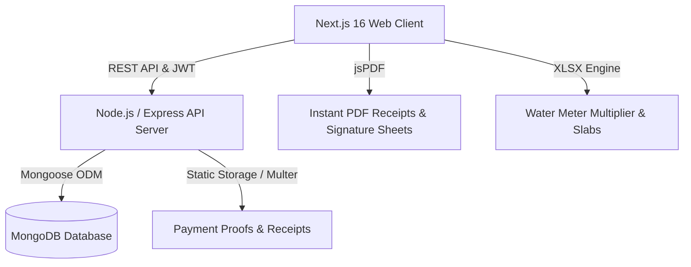

# 🏢 MANIVAASAM (మణినివాసం / मणिनिवासम्)
### *Smart Apartment Maintenance, Utility Sub-Metering & Community Platform*

[](https://nextjs.org/)
[](https://react.dev/)
[](https://nodejs.org/)
[](https://expressjs.com/)
[](https://www.mongodb.com/)
[](https://tailwindcss.com/)
[](LICENSE)

---

## 📖 Overview

**ManiVaasam** (*Rooted in **Mani (మణి / मणि)** = Jewel, Excellence + **Nivaasam (నివాసం / निवासम्)** = Abode, Residence*) represents **"The Jewel of Residences"** — a symbol of prosperous, transparent, and harmonious community living.

**ManiVaasam** is a full-stack, production-grade apartment maintenance and utility management platform tailored specifically for Indian residential communities and housing societies. It provides seamless transparency between the Management Committee (Admin) and Flat Owners/Tenants (Residents).

It eliminates spreadsheet chaos, utility billing disputes, and manual UPI reconciliation through automated water sub-meter calculations, dual portals, and instant payment proof verification.

---

## ✨ Key Features

### 1. 🚰 Advanced Water Sub-Metering Engine
- **Automated Excel / CSV Import**: Upload monthly sub-meter readings in bulk with automatic error validation and instant modal cleanup.
- **Smart 10x Multiplier Logic**: Handles standard 10x meter unit multipliers automatically, with individual meter overrides (e.g., 1x for specific flats like A-105).
- **Dual-Slab Billing & Quota Split**:
  - **Municipal / Manjeera Quota**: Base slab up to 20 KL calculated at government rates (₹13.78/KL).
  - **Private Tanker Surcharge**: Dynamically computes shared private tanker expenses and allocates costs proportionately to flats that exceed quota limits.
  - **Base Maintenance Charges**: Fixed HMWSSB ₹160 + standard common maintenance (₹1,200).
- **Printable Signature & Notice Sheets**: Generates audit-ready PDF sheets with flat-wise breakdowns and resident signature columns for physical notice board posting.

### 2. 🔐 Dual Portals & Role-Based Access Control

#### 🛡️ Management Committee (Admin Portal)
- **Executive Dashboard**: Real-time stats on monthly collections, total expenses, outstanding balances, and open complaints.
- **Flat Management**: Comprehensive directory of all flats, owners, tenants, occupancy status, and live due balances.
- **Billing & Dues Management**: Create single or bulk monthly bills, update line items, and dynamically synchronize flat balances.
- **Payment Verification Workflow**:
  - Review submitted resident payment screenshots in an interactive lightbox.
  - One-click **Approve** (marks bill as paid, decrements pending flat dues) or **Reject** with custom feedback.
- **Expense & Vendor Tracking**: Categorized expense entries (repairs, utilities, security, sanitation) with invoice attachments.
- **Complaints Desk**: Assign priority, track ticket status (Pending, In Progress, Resolved), and post official committee updates.
- **Financial & Occupancy Reports**: Visual analytics powered by Recharts with monthly collection vs. expense comparisons.
- **Society Banking & UPI Setup**: Configure society account number, IFSC, UPI ID, and custom QR codes for direct resident payments.

#### 🏡 Resident & Tenant Portal
- **Isolated Resident Login**: Secure resident authentication linked directly to their assigned flat.
- **Live Itemized Dues**: View transparent breakdown of base maintenance, municipal water, tanker surcharge, and arrears.
- **Deduction & Balance Locking**: If an admin records a payment or the bill is cleared, remaining due immediately reflects ₹0 and disables duplicate payment attempts.
- **Direct UPI Payment & Proof Upload**: Scan society QR code, pay via any UPI app (GPay, PhonePe, Paytm), and upload payment screenshots.
- **Verification Tracking**: Real-time status badges (`pending_verification`, `verified`, `rejected`).
- **Instant PDF Receipts**: Download/print branded payment receipts directly from the portal.

---

## 🏗️ Tech Stack & Architecture



- **Frontend**: Next.js 16 (App Router), React 19, TypeScript, Tailwind CSS v4, Lucide Icons, Radix UI primitives, Zustand (state persistence), Recharts, jsPDF, XLSX.
- **Backend**: Node.js, Express.js, MongoDB (Mongoose), JWT authentication, bcryptjs, Multer (file uploads), CORS, Morgan.

---

## 📁 Repository Structure

```
manivaasam/
├── apartment-maintenance-web/     # Next.js Frontend Application
│   ├── app/
│   │   ├── (auth)/                # Login & Registration Pages
│   │   ├── (dashboard)/           # Admin Portal (Billing, Flats, Collections, etc.)
│   │   ├── resident/              # Dedicated Resident Portal
│   │   ├── globals.css            # Tailwind CSS styling
│   │   └── layout.tsx             # Root Layout
│   ├── components/                # Reusable UI & Layout Components
│   │   ├── billing/               # Water billing & Excel upload modals
│   │   ├── dashboard/             # Charts & analytical cards
│   │   ├── layout/                # Sidebar, Header, Navigation
│   │   ├── shared/                # Status badges, QR modals, Receipt generators
│   │   └── ui/                    # Radix UI design system
│   ├── lib/
│   │   ├── api.ts                 # Full Axios/Fetch API client layer
│   │   ├── excelParser.ts         # Water sub-meter 10x calculation logic
│   │   └── utils.ts               # Currency, date, and string formatting
│   ├── store/                     # Zustand central application store
│   └── types/                     # TypeScript schema definitions
│
└── backend/                       # Express & MongoDB Backend API
    ├── src/
    │   ├── config/                # Database & environment configuration
    │   ├── controllers/           # Auth, Bills, Flats, Payments, Residents, Complaints
    │   ├── middleware/            # JWT auth guard (Dual Admin/Resident support)
    │   ├── models/                # Mongoose schemas (Flat, Bill, Payment, Resident, etc.)
    │   ├── routes/                # REST API route declarations
    │   └── server.js              # Express app entrypoint
    └── uploads/                   # Stored payment screenshot proofs
```

---

## 🚀 Getting Started

### Prerequisites
- **Node.js**: v18.0.0 or higher
- **MongoDB**: Local MongoDB instance (`mongodb://localhost:27017`) or MongoDB Atlas URI
- **Package Manager**: `npm`, `yarn`, or `pnpm`

---

### 1. Backend Setup

1. Open a terminal and navigate to the backend directory:
   ```bash
   cd backend
   ```

2. Install dependencies:
   ```bash
   npm install
   ```

3. Create a `.env` file in the `backend/` root:
   ```env
   PORT=5001
   MONGODB_URI=mongodb://localhost:27017/apartment-maintenance
   JWT_SECRET=manivaasam_super_secret_jwt_key_2026
   JWT_EXPIRE=30d
   ```

4. Start the backend development server:
   ```bash
   npm run dev
   ```
   > The API will be live at `http://localhost:5001/api`

---

### 2. Frontend Setup

1. Open a second terminal and navigate to the frontend directory:
   ```bash
   cd apartment-maintenance-web
   ```

2. Install dependencies:
   ```bash
   npm install
   ```

3. Create a `.env.local` file in `apartment-maintenance-web/`:
   ```env
   NEXT_PUBLIC_API_URL=http://localhost:5001/api
   ```

4. Start the Next.js development server:
   ```bash
   npm run dev
   ```
   > The web app will be accessible at `http://localhost:3000` (or `http://localhost:3001` if port 3000 is occupied).

---

## 🔑 Demo Credentials

### 1. Admin Portal
- **URL**: `http://localhost:3000/login`
- **Email**: `admin@greenviewresidency.com`
- **Password**: `password` (or your registered admin password)

### 2. Resident Portal
- **URL**: `http://localhost:3000/login` &rarr; Click **"Resident Portal"** Tab
- **Quick Demo Logins**:
  - **Flat A-104**: `A-104` / `password123`
  - **Flat A-106**: `A-106` / `password123`
  - **Flat G1**: `G1` / `password123`
- *(Residents can also self-register with their flat number and mobile number directly from the login page).*

---

## 📡 REST API Reference

| Method | Endpoint | Description | Auth Required |
| :--- | :--- | :--- | :--- |
| `POST` | `/api/auth/login` | Admin login | No |
| `POST` | `/api/auth/resident-login` | Resident login | No |
| `POST` | `/api/auth/resident-signup` | Resident registration | No |
| `GET` | `/api/flats` | List all flats & live dues | Admin |
| `GET` | `/api/bills` | Fetch monthly bills & filters | Admin |
| `POST` | `/api/bills/bulk-water` | Import monthly Excel water readings | Admin |
| `GET` | `/api/resident/my-flat` | Get logged-in resident's flat & dues | Resident |
| `GET` | `/api/resident/my-bills` | Get logged-in resident's bill history | Resident |
| `POST` | `/api/resident/submit-payment` | Submit payment with screenshot proof | Resident |
| `GET` | `/api/payments/pending-verifications` | Fetch proofs awaiting approval | Admin |
| `PUT` | `/api/payments/:id/verify` | Approve or reject payment proof | Admin |
| `GET` | `/api/complaints` | Fetch complaints & status | Admin / Resident |
| `GET` | `/api/reports/financial` | Annual collection & expense report | Admin |

---

## 📜 Water Meter Calculation Rule Summary

For any apartment sub-meter calculation:
$$\text{Total Bill} = \text{Base Maintenance} + \text{HMWSSB Fixed} + \text{Manjeera Quota Charge} + \text{Tanker Surcharge}$$

- **Manjeera Consumption**: $\min(\text{Units} \times 10, 20) \times ₹13.78$
- **Tanker Excess**: $\max(0, (\text{Units} \times 10) - 20) \times \text{Calculated Slab Rate}$
- **Special Exemption**: Configured flat meters (e.g., A-105) automatically use a $1\times$ multiplier instead of $10\times$.

---

## 🤝 Contributing

Contributions, bug reports, and feature requests are welcome!
1. Fork the Project
2. Create your Feature Branch (`git checkout -b feature/AmazingFeature`)
3. Commit your Changes (`git commit -m 'Add some AmazingFeature'`)
4. Push to the Branch (`git push origin feature/AmazingFeature`)
5. Open a Pull Request

---

## 📄 License

Distributed under the MIT License. See `LICENSE` for more information.
